## Table of Contents

- [1. About This README](#1-about-this-readme)
- [2. Project Goals](#2-project-goals)
- [3. System and Signal Flow](#3-system-and-signal-flow)
- [4. Getting Started with KiCad](#4-getting-started-with-kicad)
- [5. Project Folder Structure](#5-project-folder-structure)
- [6. Schematic Design and Reference Images](#6-schematic-design-and-reference-images)
- [7. Proposed To-Do List](#7-proposed-to-do-list)

## 1. About This README

I wrote this README to document my work on the PCB design for our capstone project and explain the current design to the group.

Sections 1–3 introduce the hardware goals and show the signal path from the electrodes to digital processing. Sections 4–6 cover KiCad basics, the project files, and how I recreated the schematics from the reference drawings and photos. I included a quick-start guide and common shortcuts to help anyone unfamiliar with KiCad get started.

The README ends with a proposed to-do list for the remaining work.

## 2. Project Goals

For the hardware portion of our capstone project, we aim to acquire ECG signals and use them to calculate heart rate (HR), heart rate variability (HRV), and other relevant metrics. We have chosen to base our approach on the system used in **ECE 4610 Biomedical Instrumentation and Signal Processing**. This system consists of an analog signal acquisition PCB, the internal analog-to-digital converter (ADC) of an STM32F407 microcontroller, and a computer-based analysis program, preferably written in Python.

Our initial PCB goal is to replicate the course’s **dual-channel ECG analog front end**. Each channel uses an instrumentation amplifier, a second-order high-pass filter, a second-order low-pass filter, and a nominal 60 Hz notch filter to condition the electrode signals before digitization. The board also uses white sockets for replaceable gain resistors and filter components. I have retained these features and used the supplied schematics and photographs to match the reference board’s connections and assembly.

I have completed the schematic design, which passes KiCad’s Electrical Rules Check (ERC) with **zero errors and zero warnings**. The next stage begins with footprint assignment, followed by PCB placement and routing. The schematic files, custom symbol library, and connection notes are included for the team members responsible for that work. Functional testing and integration with the MCU and analysis software will follow.

## 3. System and Signal Flow

The diagram below follows one channel from the user to the analysis results. CH1 and CH2 have the same main circuit structure. The boxes show the signal or data at each stage; the arrows show how it is acquired, processed, or transferred.

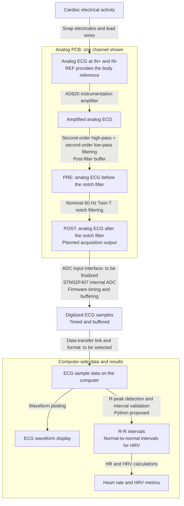

Signal path: cardiac activity -> electrodes -> amplified ECG -> high-pass and low-pass filtering -> PRE -> notch filtering -> POST -> ADC samples -> computer -> R-peak and interval analysis -> HR/HRV.

I kept both **PRE** and **POST** because the reference board provides both outputs and our first goal is to replicate that board. PRE is taken after the high-pass, low-pass, and buffer stages, before the notch filter. POST is taken after the notch filter.

In our ECE 4610 labs, we use POST to reduce 60 Hz power-line interference. POST is also the planned acquisition output for this project. I kept PRE available so we can compare the two outputs during testing and review the filtering or acquisition point based on the measured signal quality. The ADC input interface still needs to be finalized.

## 4. Getting Started with KiCad

I used **KiCad 10.0.7** for the schematic checks. KiCad is an open-source software suite for schematic capture and PCB design.

### 4.1 Download

Use the [official Windows download page](https://www.kicad.org/download/windows/), or the [main download page](https://www.kicad.org/download/) for another operating system. The [official Getting Started guide](https://docs.kicad.org/10.0/en/getting_started_in_kicad/getting_started_in_kicad.html) covers installation, libraries, and the basic workflow.

### 4.2 Open and Read the Project

1. Open KiCad and select [version_5.kicad_pro](version_5.kicad_pro). This is the project file.
2. Open [version_5.kicad_sch](version_5.kicad_sch) in the Schematic Editor. It is the root schematic and links to the two channel sheets. Keep all three `.kicad_sch` files together.
3. Use the Schematic Hierarchy panel to switch between the root sheet, **CH1 Reference Replica**, and **CH2 Reference Replica**. The root sheet contains the shared power circuit; the two subsheets contain the channel circuits.
4. The `.kicad_pcb` file is the PCB layout file. It is currently an empty board document; footprint assignment and layout remain to be done.
5. Keep `ECG_v5.kicad_sym` and `sym-lib-table` beside the project. The custom library is registered with a project-relative path, so no manual absolute-path changes should be needed.

KiCad Project Manager:

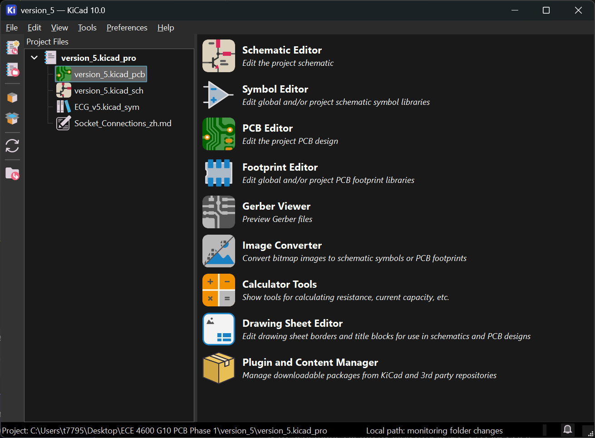

Root schematic and hierarchy:

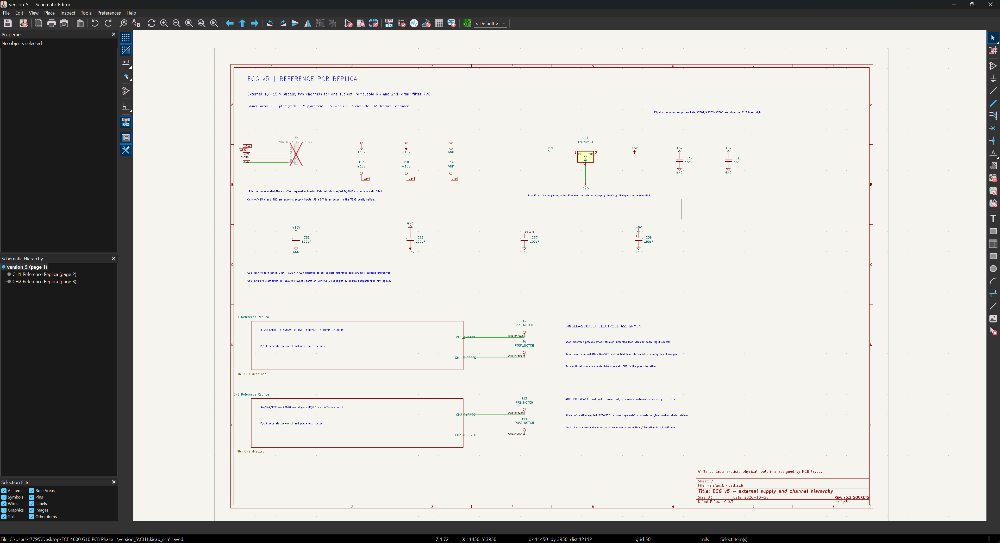

CH2 schematic:

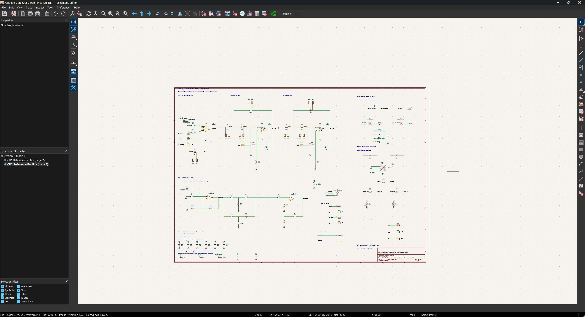

### 4.3 Useful Shortcuts

These are the default Windows shortcuts from the [Schematic Editor manual](https://docs.kicad.org/10.0/en/eeschema/eeschema.html#actions-reference). 

| Key | Action |
|---|---|
| `A` | Add a component symbol. |
| `P` | Add a power or ground symbol. |
| `W` | Draw an electrical wire. |
| `L` | Add a local net label. |
| `Ctrl + L` | Add a global net label. |
| `E` | Edit properties. |
| `M` | Move an object; its wires can be left behind. |
| `G` | Drag an object with its connected wires. |
| `R` | Rotate counterclockwise. |
| `X` / `Y` | Flip horizontally / vertically. |
| `Ctrl + D` | Duplicate the selection. |
| `Q` | Mark a pin as intentionally unconnected. |
| `Ctrl + S` | Save. |
| `Ctrl + Z` / `Ctrl + Y` | Undo / redo. |
| `Ctrl + F` | Find a component or text. |
| `Ctrl + F1` | Show the current shortcuts. |

## 5. Project Folder Structure

This README is inside `version_5`. Open the [KiCad project](version_5.kicad_pro) from this folder.

```text
ECE 4600 G10 PCB Phase 1/
    PCB pics/                    Original drawings and on-site photos
    version_5/
        README.md
        version_5.kicad_pro
        version_5.kicad_sch
        version_5.kicad_pcb
        CH1.kicad_sch
        CH2.kicad_sch
        ECG_v5.kicad_sym
        sym-lib-table
        Socket_Connections.md
        Socket_Contact_Map.json
        README_assets/
        reports/
```

| File or folder | What it contains |
|---|---|
| [version_5.kicad_pro](version_5.kicad_pro) | Project settings and the entry point for KiCad. |
| [version_5.kicad_sch](version_5.kicad_sch) | Shared power circuit and links to the two channel sheets. |
| [CH1.kicad_sch](CH1.kicad_sch), [CH2.kicad_sch](CH2.kicad_sch) | The two ECG channels, with their white sockets drawn in place. |
| [version_5.kicad_pcb](version_5.kicad_pcb) | Empty board document for the layout stage. |
| [ECG_v5.kicad_sym](ECG_v5.kicad_sym), [sym-lib-table](sym-lib-table) | Custom OPA2337PA and common five-hole socket symbols, with project-relative library registration. |
| [Socket_Connections.md](Socket_Connections.md) | Detailed socket, component-pair, and assembly notes. |
| [Socket_Contact_Map.json](Socket_Contact_Map.json) | Machine-readable socket references, connected nets, inserted component pairs, and current source hashes. |
| [README_assets/](README_assets/) | Images used in this README and the socket notes. |
| [reports/](reports/) | ERC and connection-check results for this submission. |
| [../PCB pics/](../PCB%20pics/) | Original reference drawings and the complete set of on-site photos. |

All document images and local links use relative paths. Keep the submission folders together when sharing them. The Mermaid diagram in Section 3 renders in Obsidian and other Markdown viewers with Mermaid support; a plain-text signal path is also provided below it.

## 6. Schematic Design and Reference Images

### 6.1 What I Used as References

I worked from the three supplied drawings and the photos I took on site. I used each source for a different part of the reconstruction:

| Source | How I used it |
|---|---|
| P1 | Component positions, reference designators, and the arrangement of the white sockets. |
| P2 | Power rails, U11, and the supply capacitors. |
| P3 | The complete CH2 electrical circuit and nominal values. |
| Physical board and photos | Fitted components, empty positions, socket construction, and confirmation that the channels are symmetrical. |

The original reference board:

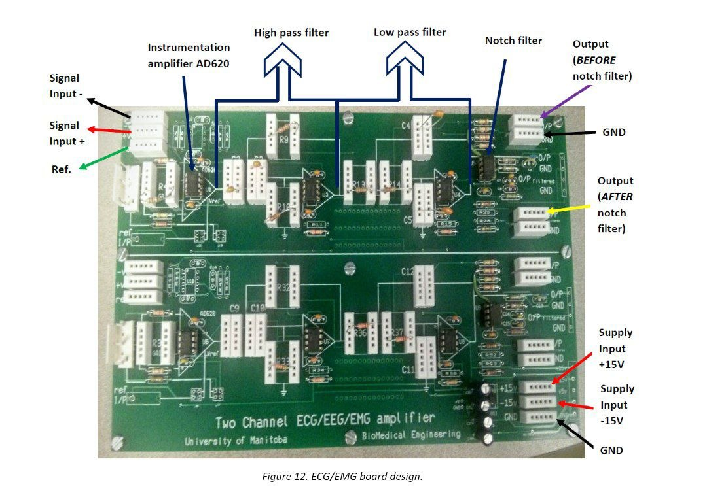

P1, the placement and silkscreen drawing:

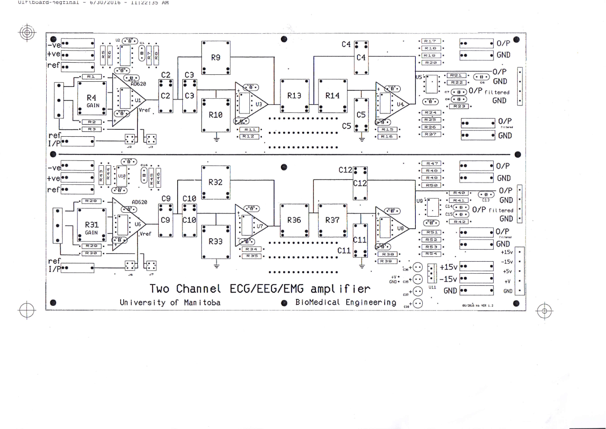

P1 is useful for locating parts, but I used P3 to check electrical connections. I used the assembled-board photos to decide which components should be fitted; bare-board photos only show the board features.

### 6.2 The Two Channels

I drew CH2 from P3 and used the confirmed channel symmetry for CH1. I kept the chip models from the supplied schematics: `AD620AN`, `LF351N`, `OPA2337PA`, and `LM7805CT`.

P3, the electrical reference for CH2:

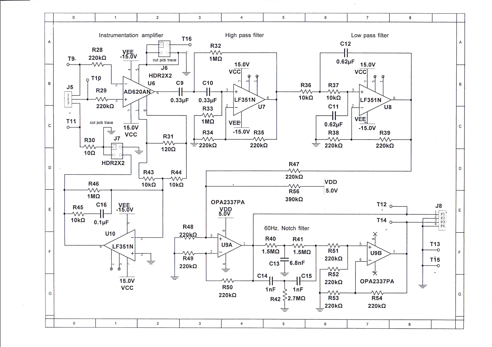

| Stage | CH2 references |
|---|---|
| Input and instrumentation amplifier | J5, R28-R31, U6 |
| High-pass filter | C9, C10, R32, R33, U7 |
| Low-pass filter | R36, R37, C11, C12, U8 |
| Post-filter buffer | R47-R50, U9A |
| Twin-T notch filter | R40-R42, C13-C15, R51, U9B |
| Optional reference drive | U10 and its surrounding components |

### 6.3 Power Supply

I followed P2 for the external +15 V, -15 V, and GND supply and the +5 V regulator circuit.

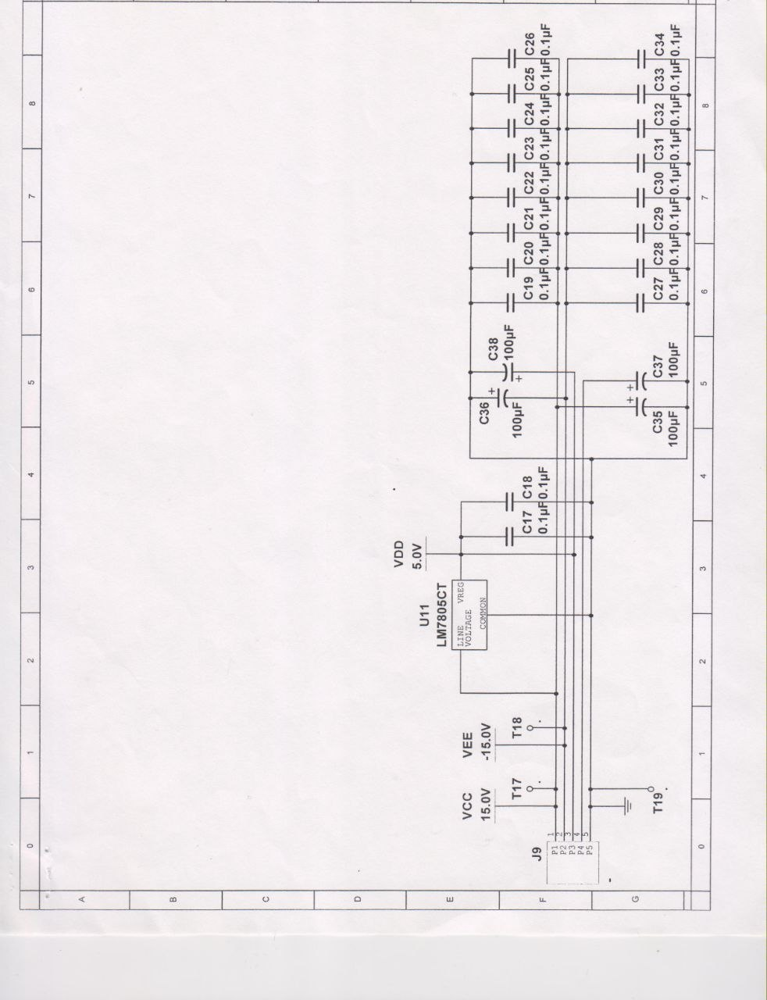

The photo below shows U11, the four bulk capacitors, and the three white power sockets on the actual board.

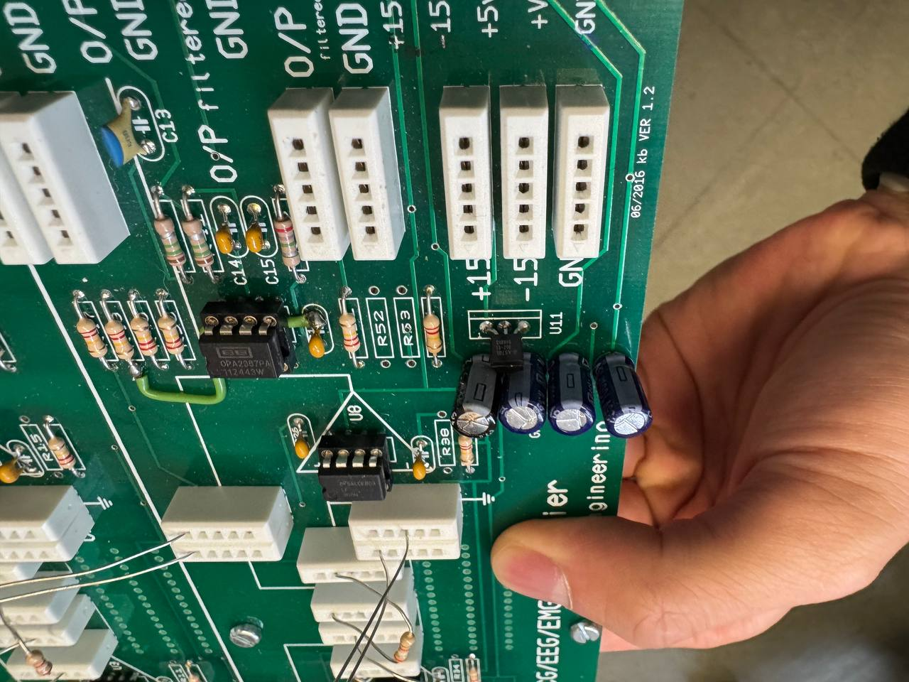

I placed the three physical supply sockets at the lower right of **CH2**: XS301 is +15 V, XS302 is -15 V, and XS303 is GND. They supply the shared rails for both channels. U11 and the rest of the power circuit remain on the root sheet.

J9 is a separate, unpopulated five-pin expansion header. Its logical pin order is +15 V, -15 V, +5 V, +V_AUX, and GND. I kept +V_AUX separate, as drawn in P2. The C19-C34 decoupling capacitors are grouped electrically in the schematic; the layout team will choose their physical positions near the ICs.

### 6.4 Inputs and Outputs

The electrode leads have a snap at the electrode end and a pin at the board end. Each channel has IN-, IN+, and electrode REF contacts, plus PRE and POST outputs with ground contacts.

| Connection | CH1 | CH2 |
|---|---|---|
| IN- | XS119 | XS219 |
| IN+ | XS120 | XS220 |
| Electrode REF | XS121 | XS221 |
| PRE | XS122 | XS222 |
| PRE GND | XS123 | XS223 |
| POST | XS124 | XS224 |
| POST GND | XS125 | XS225 |

J1 and J5 are fitted electrode headers connected in parallel with the white inputs. J4 and J8 are unpopulated auxiliary output headers. I kept the white output sockets fitted.

### 6.5 White Sockets and Replaceable Parts

The front and underside photos show the socket used in the reference PCB:

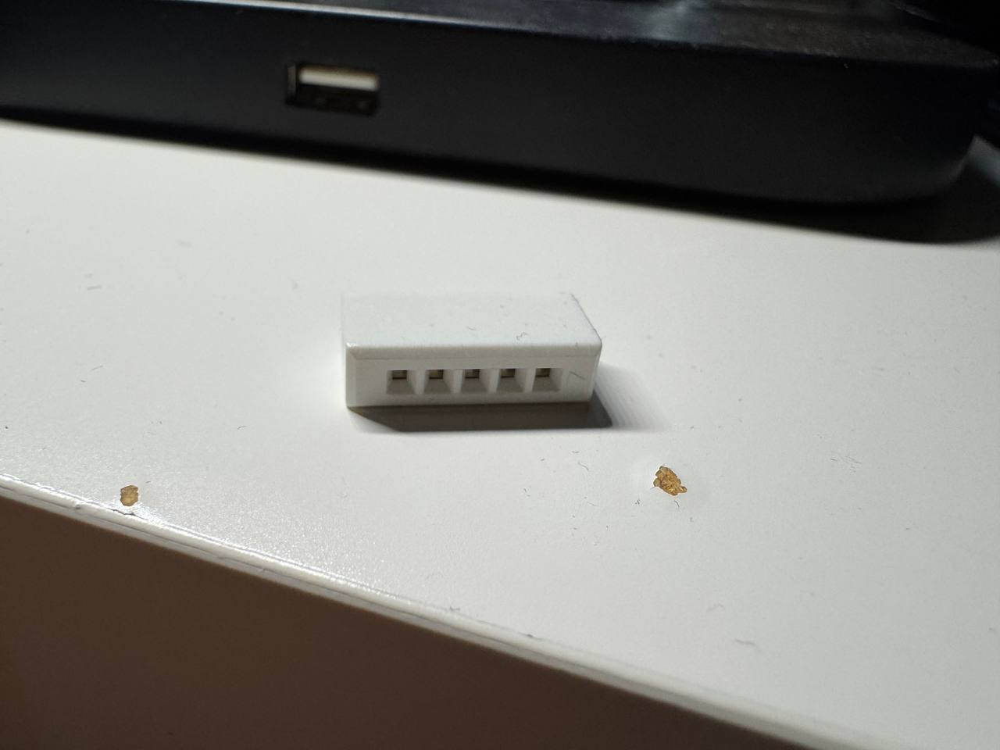

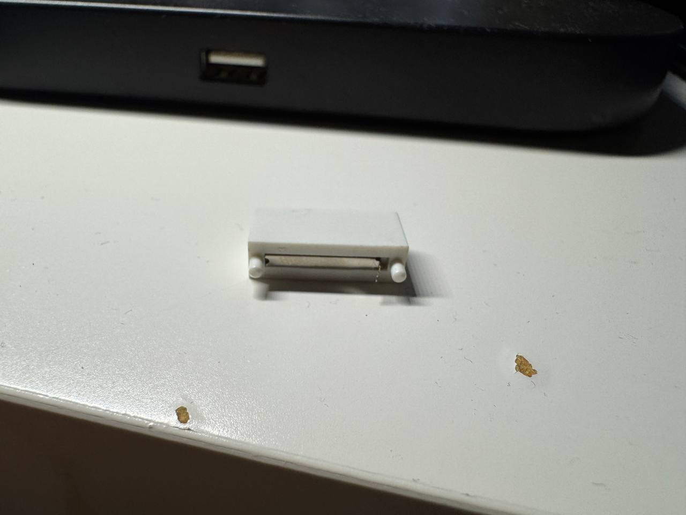

All five holes in one strip are internally connected. I therefore made `ECG_v5:Socket_5Hole_Common` with one electrical pin, numbered 1. The metal contact is soldered to the PCB; the plastic posts locate the strip, and the opposite end is secured with adhesive.

Each replaceable resistor or capacitor bridges **two separate strips**. In the updated main drawing, I placed those strips beside the component and connected them directly to its two terminals. C2, C3, R9, and R10 each have their own pair, as shown in P1.

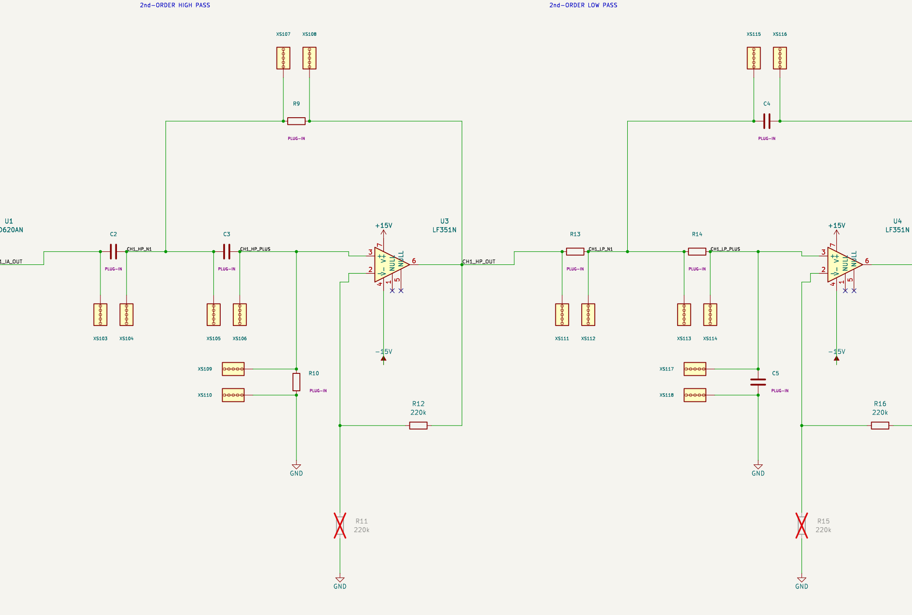

I marked the inserted parts **PLUG-IN** and moved the visible nominal values into a note below the circuit. Their values are still saved in the component properties, and the parts remain included when generating a BOM. These R/C symbols describe the parts that will be inserted; they are excluded from PCB placement. The XS symbols describe the sockets that will be soldered onto the board.

For example, R31 is inserted across XS201 and XS202. Its two leads go into different strips, using any hole in each strip.

| Channel | Part | Nominal value | Pin 1 socket | Pin 2 socket |
|---|---|---|---|---|
| CH1 | R4 | 120 ohm | XS101 | XS102 |
| CH1 | C2 | 0.33 uF | XS103 | XS104 |
| CH1 | C3 | 0.33 uF | XS105 | XS106 |
| CH1 | R9 | 1 Mohm | XS107 | XS108 |
| CH1 | R10 | 1 Mohm | XS109 | XS110 |
| CH1 | R13 | 10 kohm | XS111 | XS112 |
| CH1 | R14 | 10 kohm | XS113 | XS114 |
| CH1 | C4 | 0.62 uF | XS115 | XS116 |
| CH1 | C5 | 0.62 uF | XS117 | XS118 |
| CH2 | R31 | 120 ohm | XS201 | XS202 |
| CH2 | C9 | 0.33 uF | XS203 | XS204 |
| CH2 | C10 | 0.33 uF | XS205 | XS206 |
| CH2 | R32 | 1 Mohm | XS207 | XS208 |
| CH2 | R33 | 1 Mohm | XS209 | XS210 |
| CH2 | R36 | 10 kohm | XS211 | XS212 |
| CH2 | R37 | 10 kohm | XS213 | XS214 |
| CH2 | C12 | 0.62 uF | XS215 | XS216 |
| CH2 | C11 | 0.62 uF | XS217 | XS218 |

I counted **25 fitted strips on CH1** and **28 on CH2**. CH2's 28 consist of 18 R/C strips, three inputs, four outputs, and three supply strips. T8 and T16 are additional DNP external REF contacts. The whole schematic contains 55 strip symbols, of which 53 are fitted.

Other T references are schematic node markers excluded from the PCB and BOM. The layout team will measure the actual sockets and define their pad, locating-hole, and body geometry.

### 6.6 Assembly Choices

I used the inspected board to settle differences between the drawings and the actual assembly. DNP means "Do Not Populate"; a crossed-out DNP symbol records a position that stays empty.

| Item | What I kept in the schematic |
|---|---|
| R55 and R56 | Removed because neither branch exists on the inspected board. The IC supply connections remain. |
| U11 and main supply components | Fitted. |
| R11, R15, R25, R26 | DNP in CH1. |
| R34, R38, R52, R53 | DNP in CH2. |
| U2, U10, and associated optional drive components | DNP. |
| J2, J3, J6, J7, T8, T16 | DNP reference options. |
| J4, J8, J9 | DNP auxiliary headers; the white output and supply sockets stay fitted. |

With R55 and R56 removed, I no longer describe the buffer as adding the source drawing's +2.2 V offset.

JP101, JP102, JP201, and JP202 represent normally closed, cuttable copper traces. I kept them so the default reference connections remain even when the selection headers are empty. They ground the AD620 REF pins and return the electrode REF connections to GND through R3 or R30. They are PCB features, not purchased jumpers.

The four-pin reference headers use logical numbering: pins 1 and 3 share the common node, while pins 2 and 4 are selection connections. Their physical pad numbering still needs checking during footprint assignment.

### 6.7 Checks

On **October 28, 2026**, I reran KiCad CLI 10.0.7 and the connection checks against the files in this submission.

| Check | Result | Report |
|---|---|---|
| ERC | 0 errors, 0 warnings | [ERC.json](reports/ERC.json) |
| Circuit connections and assembly | 227 checks passed | [Connectivity_Audit.json](reports/Connectivity_Audit.json) |
| Socket model and connections | 353 checks passed | [Socket_Audit.json](reports/Socket_Audit.json) |
| Socket placement and sheet counts | 25 checks passed | [Inline_Layout_Audit.json](reports/Inline_Layout_Audit.json) |

All exported component values, assembly properties, and pin connections match the previously checked design. The circuit report covers signal connections, power rails, component values, and fitted/DNP assembly. The [assembly inventory](reports/Assembly_Inventory.json) separates PCB sockets, inserted components, node markers, and other parts. The [submission validation report](reports/Submission_Validation.json) records the file and link checks.

These are electrical-rule and connection checks. I have not completed functional simulation or bench measurements of gain, filter response, noise, or ADC compatibility. Human-use protection and isolation have not been validated.

## 7. Proposed To-Do List

These are my suggestions for the next team discussion. They cover the PCB, MCU, and analysis software. I have not assigned owners or dates yet.

### PCB Layout and Component Purchasing

- [ ] **Footprints:** Check IC package pin mapping and measure the sockets, locating posts, and solder contacts.
- [ ] **PCB layout:** Complete the board outline, placement, routing, and normally closed copper links using the reference board.
- [ ] **Analog testing:** Use a known input to check gain, filter response, and the PRE/POST outputs.
- [ ] **Channel ICs:** Purchase eight ICs for the two signal channels: AD620AN x 2, LF351N x 4, and OPA2337PA x 2. Confirm whether U11 (LM7805CT), the shared regulator, also needs to be purchased. Check with the ECE tech shop for the remaining components.
- [ ] **Review with Zoran:** Confirm the reconstruction and remaining questions with Zoran, who is responsible for the reference boards' design and maintenance, before proceeding with fabrication. 

### MCU Setup

- [ ] **MCU interface:** Start with POST as the planned output, select the ADC pins, and compare the PCB output range with the MCU input range and reference. Determine the required input conditioning and protection; review the output choice after bench testing.
- [ ] **ADC setup:** Agree on the sample rate, resolution, and acquisition arrangement for the two channels.
- [ ] **Firmware:** Implement sample timing, buffering, and continuous acquisition.
- [ ] **Data transfer:** Choose the connection method and define the sample format, channel order, and timing information.

### Data Export and Analysis

- [ ] **Analysis software:** Import the samples, plot the waveform, and agree on the digital processing and analysis functions to implement.
- [ ] **System integration:** Test the PCB, MCU, and software together with a known input and record the results.
