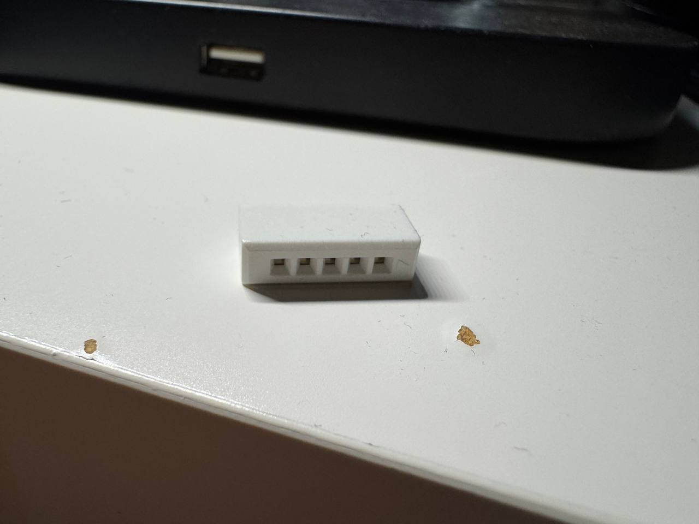
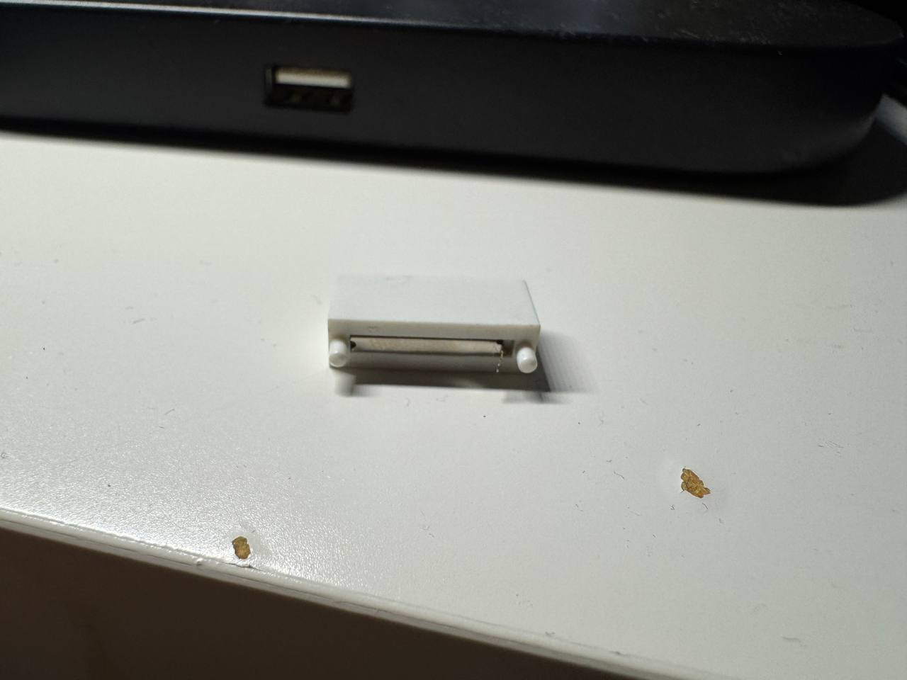
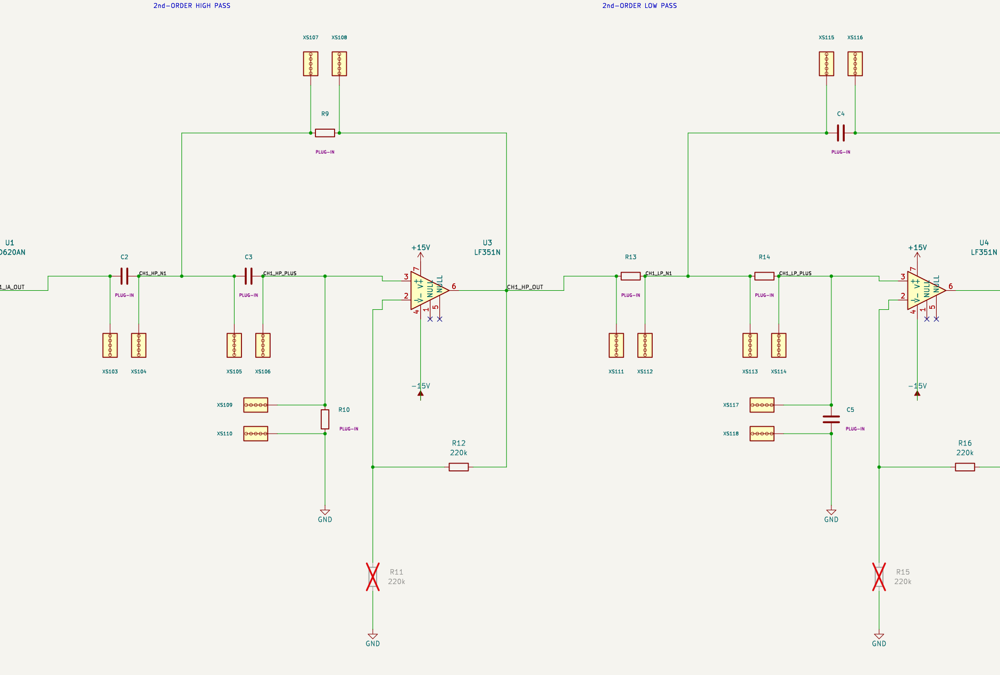

# White Five-Hole Sockets and Replaceable Components

Updated: October 28, 2026.

Each white strip has five internally connected holes and one electrical contact. The schematic represents it with `ECG_v5:Socket_5Hole_Common`, which has one passive electrical pin, numbered 1. XS references are sockets soldered onto the PCB. The plastic posts locate the strip; the metal contact is soldered, and the opposite end is secured with adhesive.

## Reading the Schematic

Each replaceable resistor or capacitor bridges two separate strips. I placed the strips beside the component terminals in CH1 and CH2 and connected them directly to those terminals. The component is marked **PLUG-IN**. Its nominal value is saved in its properties and listed below the circuit, rather than displayed beside the symbol.

The inserted R/C symbols are excluded from PCB placement but remain included when generating a BOM for manual insertion. The XS symbols represent the physical sockets. Do not add fixed solder pads for the inserted R/C symbols as well as the socket footprints.

For example, **R31 (120 ohm) bridges XS201 and XS202**. Insert one lead into any hole of XS201 and the other into any hole of XS202. Each strip is internally common, but the two strips are separate circuit nodes.

## Replaceable Components and Socket Pairs

| Channel | Part | Nominal value | Pin 1 socket | Pin 2 socket |
|---|---|---|---|---|
| CH1 | R4 | 120 ohm | XS101 | XS102 |
| CH1 | C2 | 0.33 uF | XS103 | XS104 |
| CH1 | C3 | 0.33 uF | XS105 | XS106 |
| CH1 | R9 | 1 Mohm | XS107 | XS108 |
| CH1 | R10 | 1 Mohm | XS109 | XS110 |
| CH1 | R13 | 10 kohm | XS111 | XS112 |
| CH1 | R14 | 10 kohm | XS113 | XS114 |
| CH1 | C4 | 0.62 uF | XS115 | XS116 |
| CH1 | C5 | 0.62 uF | XS117 | XS118 |
| CH2 | R31 | 120 ohm | XS201 | XS202 |
| CH2 | C9 | 0.33 uF | XS203 | XS204 |
| CH2 | C10 | 0.33 uF | XS205 | XS206 |
| CH2 | R32 | 1 Mohm | XS207 | XS208 |
| CH2 | R33 | 1 Mohm | XS209 | XS210 |
| CH2 | R36 | 10 kohm | XS211 | XS212 |
| CH2 | R37 | 10 kohm | XS213 | XS214 |
| CH2 | C12 | 0.62 uF | XS215 | XS216 |
| CH2 | C11 | 0.62 uF | XS217 | XS218 |

## Inputs, Outputs, and Power

| Sheet | Contact | Function | Net | Population |
|---|---|---|---|---|
| CH1 | T8 | Standalone external REF input | CH1_EXT_REF | DNP |
| CH1 | XS119 | Electrode IN- | CH1_IN_MINUS | Fitted |
| CH1 | XS120 | Electrode IN+ | CH1_IN_PLUS | Fitted |
| CH1 | XS121 | Electrode REF | CH1_ELECTRODE_REF | Fitted |
| CH1 | XS122 | Output PRE | CH1_BYPASS | Fitted |
| CH1 | XS123 | Output GND | GND | Fitted |
| CH1 | XS124 | Output POST | CH1_FILTERED | Fitted |
| CH1 | XS125 | Output GND | GND | Fitted |
| CH2 | T16 | Standalone external REF input | CH2_EXT_REF | DNP |
| CH2 | XS219 | Electrode IN- | CH2_IN_MINUS | Fitted |
| CH2 | XS220 | Electrode IN+ | CH2_IN_PLUS | Fitted |
| CH2 | XS221 | Electrode REF | CH2_ELECTRODE_REF | Fitted |
| CH2 | XS222 | Output PRE | CH2_BYPASS | Fitted |
| CH2 | XS223 | Output GND | GND | Fitted |
| CH2 | XS224 | Output POST | CH2_FILTERED | Fitted |
| CH2 | XS225 | Output GND | GND | Fitted |
| CH2 | XS301 | External supply +15V | +15V | Fitted |
| CH2 | XS302 | External supply -15V | -15V | Fitted |
| CH2 | XS303 | External supply GND | GND | Fitted |

There are **25 fitted strips on CH1** and **28 on CH2**. CH2 includes 18 R/C strips, three electrode inputs, four output contacts, and three shared power contacts at its lower right. The power contacts supply both channels; they are not duplicated on the root sheet.

The full design has **55 socket symbols: 53 fitted and two DNP**. T8 and T16 are unpopulated standalone external REF contacts and are not included in the 25/28 fitted counts. The fitted total consists of 36 R/C strips, six electrode inputs, eight output contacts, and three power contacts.

## Other Connectors and Node Markers

- J1 and J5 are fitted three-pin electrode headers connected in parallel with the white input sockets.
- J4 and J8 are DNP auxiliary output headers. The white PRE, POST, and ground sockets remain fitted.
- J9 is a DNP five-pin power expansion header. External power enters through XS301 (+15 V), XS302 (-15 V), and XS303 (GND).
- T8 and T16 use the custom socket symbol for the DNP standalone external reference contacts.
- Other T references are schematic node markers excluded from the PCB and BOM; they do not create additional physical test pads.
- JP101, JP102, JP201, and JP202 are normally closed, cuttable copper links. Preserve their default connections even though the selection headers are DNP. They are PCB features, not purchased jumpers.

## Footprints and Assembly Fields

The project includes `ECG_v5.kicad_sym` and the project-relative `sym-lib-table`. The socket footprint must use electrical pad number 1 for its single metal contact. Plastic locating features are mechanical and must not be assigned extra electrical pins. The layout team needs to measure the actual socket before defining the pad, holes, body outline, and adhesive area. Symbol drawing dimensions do not specify the footprint geometry.

The `Socket_Pair` field identifies each inserted component's two sockets. The `AssemblyRole` field distinguishes `PCB_SOCKET`, `INSERTED_COMPONENT`, and `SCHEMATIC_NODE_MARKER`. The [contact map](Socket_Contact_Map.json) contains the electrical mapping, and the [assembly inventory](reports/Assembly_Inventory.json) groups the parts for review.

## Checks

The submitted design passed ERC with **0 errors and 0 warnings**, 227 circuit and assembly checks, 353 socket checks, and 25 placement and sheet-count checks on October 28, 2026. These checks confirm connections and assembly conventions; they do not establish analog performance.

See [README Section 6.7](README.md#67-checks) for the linked reports.
